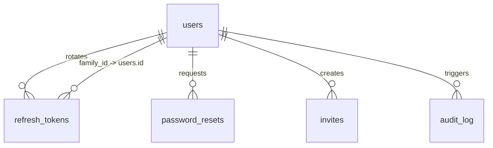

# SafariDesk — Database Guide

Postgres. Migrations live in `backend/migrations/` and are applied in filename order.
The PDF guide remains the source for the **domain** schema; only the auth/RBAC schema
exists in migrations today.

## Current migrations

| File | Status | Contents |
|---|---|---|
| `001_init.sql` | placeholder (empty) | reserved for the domain schema |
| `002_seed.sql` | placeholder (empty) | reserved for reference/seed data |
| `003_demo.sql` | placeholder (empty) | reserved for demo bookings/drivers |
| `004_auth.sql` | live | `users`, `refresh_tokens`, `password_resets`, `invites`, `audit_log` |
| `005_rbac.sql` | live | role rename `staff → operations`, role CHECK constraints |
| `006_staff_requests.sql` | live | `users.requested_role`, `status='pending'` constraint, partial index |

Apply with the repo runner (records applied files in `schema_migrations`, so
re-runs are no-ops):

```bash
DATABASE_URL=postgres://… npm run migrate      # backend/
```

Or by hand:

```bash
for f in backend/migrations/*.sql; do psql "$DATABASE_URL" -f "$f"; done
```

Rollback = run each `DROP TABLE IF EXISTS …` in reverse order (Postgres 15+ can also
wrap each file in a transaction; these scripts are written idempotently with
`IF NOT EXISTS`/`IF EXISTS`). Migrations that insert data are re-appliable because
they use `ON CONFLICT`/guarded updates.

## Auth / RBAC schema (live)

- **users** — `id uuid pk`, `name`, `email citext unique`, `password_hash` (bcrypt),
  `role` ∈ {super_admin, admin, operations, dispatcher, finance, agent, driver, customer},
  `status` ∈ {active, invited, pending, disabled}, `requested_role` (staff role asked
  for at self-signup), `failed_attempts`, `locked_until`, `last_login_at`, `created_at`.
- **refresh_tokens** — sha256 of the raw token only (`token_hash`), `family_id` for
  rotation/reuse detection, `user_agent`, `ip inet`, `expires_at`, `revoked_at`,
  `replaced_at`. Index on `family_id`; reuse queries include revoked rows.
- **password_resets** — single-use, `expires_at` (30 min); token stored hashed.
- **invites** — staff onboarding (`role`, `status`, token hash, expiry).
- **audit_log** — actor, action, target, metadata JSONB, ip, created_at. Written by
  auth events, user admin actions and RBAC changes.

## Planned domain schema (not yet migrated)

From `SafariDesk_SRS.pdf`: `parks`, `attractions`, `drivers`, `vehicles`, `bookings`
(+ items/itinerary), `payments` (M-Pesa), `rates`, `alerts`, `feedback`, `customers`,
`documents`, `reports`. These land in `001_init.sql`/`003_demo.sql` when the domain
services are built; until then the API runs on MSW mocks or the auth memory store.

## ERD (auth slice)



Domain entities join on `bookings.customer_id -> users.id` (customer role) and
`bookings.driver_id -> drivers.user_id`.

## Seed users

Dev credentials: the memory store bootstraps an admin at startup; Postgres uses
`npm run seed:demo` (one user per role, idempotent upsert, refuses in production).

| Role | Email | Password | Home |
|---|---|---|---|
| admin | `admin@safaridesk.app` | `password123` | /dashboard |
| super_admin | via invite only | — | /dashboard |
| operations | `ops@safaridesk.app` | `password123` | /dispatch |
| dispatcher | via invite / seed | `password123` | /dispatch |
| finance | `finance@safaridesk.app` | `password123` | /payments |
| agent | `agent@safaridesk.app` | `password123` | /bookings |
| driver | `driver@safaridesk.app` | `password123` | /driver |
| customer | `amina@example.com` | `password123` | /my-trips |

Staff roles requested through `/sign-up` stay `pending` until an admin approves
them on `/users`. Rotate `DEMO_PASSWORD`/`ADMIN_PASSWORD` in any real environment;
never commit credentials.
